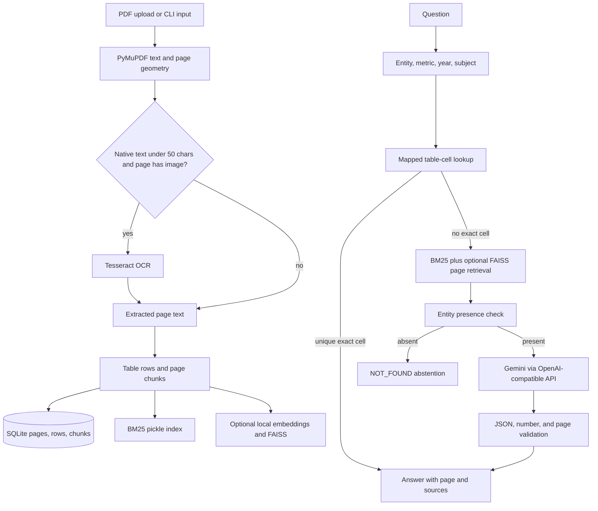

# Report Navigator: Project Guide

This guide describes the current project code and local setup. It covers how a PDF becomes an answer, why each technology is used, how results are evaluated, what evidence supports an answer, and where the system still needs work.

**Revision basis:** repository HEAD `c697102` (`Fix multiple questions can be asked in one session`, 2026-10-31). Local configuration and ingested data are machine-specific and are not part of the code revision.

## 1. What the project does

Report Navigator is a Python application for asking questions about long statistical PDF reports. Its main supported task is returning a **single integer count** with a PDF page citation, or `NOT_FOUND`. The supplied example data contains a 272-page road-accident report and 50 questions: 45 numeric answers and 5 `NOT_FOUND` answers.

The app has a Streamlit chat interface and a batch command-line path. It can ingest another PDF at runtime. It does not have fixed answers for the example questions.

The current answer contract is numeric. Questions such as “name two people shown in the report” are outside that contract: the prompt and validator reject names, and PDF page images are not sent to Gemini.

## 2. Architecture at a glance



The app is a single-process Streamlit application. `app.py` calls Python service modules directly; there is no separate HTTP backend. The key code paths are:

| Area | Main files | Responsibility |
|---|---|---|
| UI and entry points | `app.py`, `run_batch.py`, `evaluate.py` | Chat, uploads, batch answers, and score reporting |
| Configuration and storage | `src/config.py`, `src/db.py`, `src/models.py` | Environment settings, SQLite schema/queries, shared dataclasses |
| Ingestion | `src/ingest/` | PDF text, OCR, table rows, chunks, and indexes |
| Question answering | `src/qa/` | Context extraction, cell lookup, retrieval, Gemini request, validation |
| Service orchestration | `src/services/` | Connect UI/CLI to ingestion, chat, and batch workflows |

## 3. From PDF to searchable data

### 3.1 Page extraction and OCR

`src/ingest/pdf_loader.py` reads page words and sorts them by vertical and horizontal position. This is needed because some source PDFs store text in an order that differs from how a person reads the page. It also renders each page as a PNG for citation previews.

`src/ingest/ocr.py` is a fallback for image-based pages. OCR runs only when the extracted native text is shorter than 50 characters **and** the page contains an embedded image. Tesseract returns plain text; it does not reliably preserve table geometry or explain graph shapes.

### 3.2 Table extraction and chunks

`src/ingest/table_extract.py` first tries PyMuPDF table detection on number-dense pages. When it cannot map a table confidently, it falls back to numeric rows from coordinate-sorted text. In both cases row values can be stored even when column names are unknown. This distinction matters: a row of numbers without a reliable header-to-column map is searchable evidence, but it is not safe for exact SQL cell lookup.

`src/ingest/chunker.py` creates three chunk types:

- **Page:** the full extracted page text, capped at 20,000 characters.
- **Narrative:** overlapping text windows of about 800 characters, with 120 characters of overlap.
- **Table row:** the row label, table title, and mapped columns or ordered values.

The PDF page number is stored and cited as a 1-based number. A printed footer number, when found, is not used as the citation number.

### 3.3 Storage and indexes

SQLite (`data/db/report.db`) stores documents, page text, table rows, chunks, and QA history. The PDF copy, page preview images, and indexes live under `data/` by document ID. The document ID is derived from the first 12 characters of the PDF's SHA-256 hash.

BM25 is always built as a local pickle index. Optional FAISS vectors cover narrative and table-row chunks; page text is still used for answering. The embedding model is `BAAI/bge-small-en-v1.5`. In this workspace it is configured for local cache use. If FAISS or Sentence Transformers are unavailable, retrieval falls back to BM25.

## 4. How a question becomes an answer

1. **Parse the question.** `src/qa/entity.py` detects a metric (such as deaths, injuries, or accidents), year, supported subject keywords, and a report entity by matching stored table-row labels. RapidFuzz supports approximate label matches.
2. **Try a mapped table cell.** `src/qa/cell_lookup.py` looks for an exact entity row and a mapped metric/year column. It answers only when the value is unambiguous. Rows whose headers could not be mapped do not qualify for this path.
3. **Retrieve pages.** `src/qa/hybrid_search.py` ranks pages using custom BM25 and, when available, FAISS similarity. Entity matches and table-row matches receive ranking bonuses. Singular/plural query variants are added to improve wording matches. The default is five candidate pages.
4. **Abstain if the entity is absent.** The entity check looks across page text and exact stored row labels. If it cannot find the entity, the app returns `NOT_FOUND` without calling Gemini.
5. **Ask Gemini when needed.** `src/qa/answerer.py` sends up to five retrieved pages, each limited to 6,000 characters, to the configured OpenAI-compatible endpoint. The current prompt supports integer answers and `NOT_FOUND` only.
6. **Validate the response.** The app parses the JSON response, normalizes comma-grouped integers, checks that the page is one of the candidate pages, and checks that the number appears somewhere on the cited page. If it appears on another candidate page, the validator can relocate the citation.
7. **Show evidence.** The UI displays source passages and a rendered page preview. An expandable Gemini trace shows the request payload (without the API key), response status, and raw response or error. Answers served by deterministic lookup or abstention show that Gemini was not called.

Gemini is configured through `.env`, not hardcoded in Python. The local `.env` currently selects the Gemini OpenAI-compatible endpoint and `gemini-3.8-flash`; the code defaults to Groq if no local override is provided. `.env` is ignored by Git and must never be committed.

**Important boundary:** page images are rendered for UI citation only. The current LLM request sends extracted text, not image content. OCR may recover text from a scanned page, but the system does not visually interpret photographs, charts, or the spatial structure of a table.

## 5. Technologies and alternatives

| Purpose | Used here | Why | Alternatives and trade-offs |
|---|---|---|---|
| Language | Python | Strong PDF, OCR, data, and ML ecosystem; fast to iterate | Java/Kotlin or C# can provide stricter application structure but have fewer ready-made PDF/ML examples |
| PDF text and rendering | PyMuPDF | Fast, exposes word coordinates, page rendering, and table detection | `pdfplumber` is useful for table inspection but can be slower; `pypdf` is lighter but has less layout/render support |
| OCR | Tesseract through `pytesseract` and Pillow (optional) | Local and inexpensive; adequate for basic scanned text | PaddleOCR/EasyOCR may improve some layouts; cloud OCR can provide stronger document layout at added cost and data-transfer implications |
| Tables and structured rows | SQLite via Python `sqlite3` | No server, one local file, and sufficient for this report scale | PostgreSQL is better for multi-user concurrent service workloads; a document database does not by itself solve column interpretation |
| Keyword retrieval | In-repository BM25 implementation | Fast and dependency-free; exact names and years matter in statistics tables | `rank-bm25` is a maintained library alternative; Elasticsearch/OpenSearch adds operational setup and richer query tooling |
| Vector retrieval | FAISS and local Sentence Transformers (optional) | Local embeddings avoid a per-query embedding API and FAISS needs no server | Chroma or pgvector provide more managed metadata workflows; hosted vector services add network, cost, and data handling |
| Embedding model | `BAAI/bge-small-en-v1.5` | Small local English model suitable for semantic similarity | Other local models may improve multilingual/domain performance; Gemini embeddings reduce local dependencies but send text to an API |
| Answer model | Gemini through OpenAI-compatible HTTP endpoint | Reuses a small stdlib `urllib` client and can be changed via environment variables | Google GenAI SDK exposes Gemini-native and multimodal features; direct SDK use is preferable for image questions and advanced Gemini options |
| UI | Streamlit | Upload, progress, chat, and batch results in one Python app | FastAPI plus React offers more control and deployment separation but requires more code and services |
| Validation | Regular expressions and Python logic | Small, inspectable numeric-answer contract | Pydantic or JSON Schema can validate richer structured output, but schema validation alone cannot verify a table column |
| Configuration | `python-dotenv` and environment variables | Keeps local credentials and endpoint settings out of source code | Deployment secrets managers are safer for hosted multi-user production environments |

Core dependencies are in `requirements.txt`: PyMuPDF, Streamlit, python-dotenv, RapidFuzz, and pandas. `requirements-optional.txt` contains Sentence Transformers, FAISS, Tesseract bindings, Pillow, and pdfplumber. OCR also requires the system Tesseract executable. There is no LangChain, separate vector database, or separate API server in the current implementation.

## 6. Metrics and what they mean

`evaluate.py` compares `answers.jsonl` with a gold JSONL file. It currently reports:

| Metric | Meaning | Limitation |
|---|---|---|
| Exact match (%) | Predicted answer string exactly equals the gold answer, divided by gold question count | Does not give partial credit; numeric normalization must already match the output format |
| Page accuracy (%) | Among numeric gold questions answered with a number, predicted PDF page is among `gold_pages` | Measures citation page only, not whether the selected cell/column is correct; `NOT_FOUND` and missing predictions are excluded from this denominator |
| `NOT_FOUND` precision | Of predicted `NOT_FOUND` answers, the share that are gold `NOT_FOUND` | Depends on the evaluation set's balance of answerable and unanswerable questions |
| `NOT_FOUND` recall | Of gold `NOT_FOUND` questions, the share predicted as `NOT_FOUND` | High recall alone can hide excessive abstention on answerable questions |

Useful additional metrics for the next evaluation pass:

- **Retrieval Recall@K:** whether a gold answer page appears among the top K pages sent to Gemini.
- **Answer coverage:** fraction of questions answered with a numeric value rather than `NOT_FOUND`.
- **Evidence/column accuracy:** whether the cited row and header intersection is correct, not merely whether the number occurs somewhere on the page.
- **Latency and cost per question:** include embedding time, Gemini requests, retries, and token usage.
- **Confidence calibration:** whether answers given confidence 0.8 are correct about 80% of the time.

## 7. Results available in this workspace

The current local SQLite database contains the example report with **272 pages, 7,352 chunks, 6,333 parsed table rows, and 170 pages containing table rows**. It reports zero pages processed by OCR; this copy appears to have a native text layer. The available gold question file contains 50 questions: 45 numeric and 5 `NOT_FOUND`.

These are ingestion and dataset counts, **not answer-quality scores**. There is no saved `answers.jsonl` or evaluation output in the workspace, so this guide does not claim an exact-match or page-accuracy result. A prior interactive run returned the Pune figure 351 on page 101. A separate manual inspection found the Kollam two-wheeler killed value 124 on page 241, while an earlier app response incorrectly abstained. That is evidence of a known retrieval/table-header failure, not a completed benchmark result.

The smoke test in `tests/test_gold_smoke.py` checks ingestion counts, the Pune row on page 101, and retrieval recall for that page. `tests/test_normalize.py` checks number parsing and validation. These tests do not evaluate Gemini answer accuracy over all 50 questions. They were not run while preparing this guide. The smoke test removes `LLM_API_KEY` before importing the app, but `python-dotenv` may load it again from a local `.env`; therefore the test is not guaranteed to be API-free when a keyed `.env` exists.

## 8. How we know whether an answer is accurate

There are several layers of evidence, and they provide different levels of assurance:

1. **Value presence:** the validator confirms a numeric answer appears on a candidate page. This catches some hallucinated numbers.
2. **Page citation:** the page must be one of the pages shown to Gemini, or the validator relocates it to a candidate page containing the number.
3. **Source inspection:** a person can open the cited passage and page image and confirm the requested row and column.
4. **Gold evaluation:** exact match and page accuracy compare a batch against known answers.

The current validator does **not** prove that the number belongs to the requested column. A page may contain many numbers, including the wrong year's value or a neighboring category. The LLM's confidence is not calibrated. The deterministic lookup's 0.95 is a code-assigned confidence, not a measured probability. `NOT_FOUND` confidence from Gemini is capped at 0.5; the separate early entity-absent path currently uses 0.8. Confidence should therefore be treated as a display hint, not a guarantee.

For stronger assurance, evaluate on the full gold set, review every numeric answer against its row and header, track retrieval Recall@K, and calibrate confidence against held-out examples. Do not treat a successful JSON response or a value appearing somewhere on the page as proof of correctness.

## 9. Known limitations and priorities

1. **Numeric-only response contract.** Names, explanations, lists, and graph descriptions are rejected. Supporting them needs a richer answer schema and validator.
2. **No visual Gemini input.** People in photos and graph shapes are invisible to the current model request. A multimodal path must send relevant rendered page images to Gemini and explain how image answers are cited.
3. **Unmapped table headers.** Multi-row or grouped headers often leave `columns_json` empty. Rows remain searchable, but exact cell lookup cannot use their numbers safely.
4. **Retrieval can omit the answer page.** Gemini sees only the top five pages, each truncated to 6,000 characters. If the relevant page or header falls outside this context, the prompt cannot recover it.
5. **Validation is page-level.** It checks whether the answer number exists on the page, not whether the table cell matches the question.
6. **OCR limitations.** OCR can misread digits and loses spatial structure; OCR text alone is weak evidence for dense tables and charts.
7. **Confidence and evaluation gaps.** There is no verified whole-dataset score in the workspace, no confidence calibration, and no retrieval recall report.
8. **API latency and errors.** Gemini calls can time out; the client retries invalid outputs with the same context. Track request latency, timeout rate, and whether retries improve accuracy.

Recommended order of work: (1) run and save a full gold evaluation; (2) improve multi-level table header mapping and check row/column evidence; (3) measure retrieval Recall@5 and expand/re-rank context when the gold page is missing; (4) add OCR/table confidence signals; (5) add multimodal graph/photo questions only with a compatible answer schema and explicit citation rules.

## 10. Run and evaluate

Create a local `.env` with the endpoint, model, and API key. Never paste the key into source code or share a Gemini trace without checking its prompt text; the trace deliberately includes the report text sent to the provider.

```dotenv
LLM_API_KEY=<your Gemini API key>
LLM_BASE_URL=https://generativelanguage.googleapis.com/v1beta/openai/
LLM_MODEL=gemini-3.8-flash
LLM_TIMEOUT_S=180
LLM_CONTEXT_PAGES=5
RETRIEVAL_TOP_PAGES=5
EMBEDDING_MODEL=BAAI/bge-small-en-v1.5
HF_HUB_OFFLINE=1
```

Run the UI:

```powershell
python -m venv .venv
.venv\Scripts\Activate.ps1
python -m pip install -r requirements.txt
# Optional: embeddings / FAISS and OCR support
python -m pip install -r requirements-optional.txt
streamlit run app.py
```

Run a full batch and score it against the available gold data:

```powershell
python run_batch.py --pdf dataset\report_A.pdf --questions dataset\questions_with_answers.jsonl --out answers.jsonl
python evaluate.py --answers answers.jsonl --gold dataset\questions_with_answers.jsonl --out metrics.json
```

The batch command makes Gemini requests when a key is configured. It may reuse an already-ingested PDF; add `--force` to re-ingest it. Save the resulting answers and metrics with the evaluation date and model name so future comparisons are reproducible.
